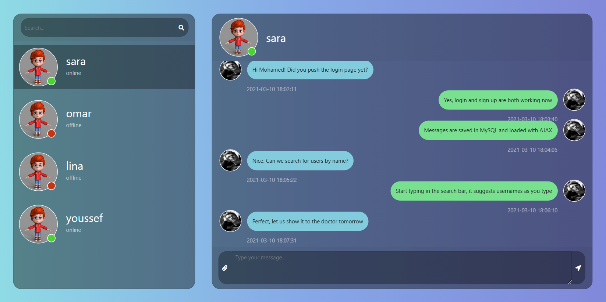
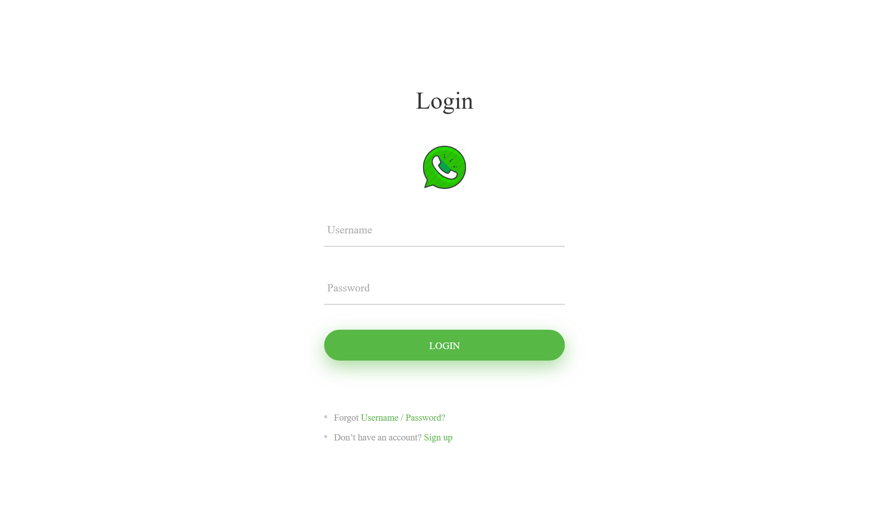
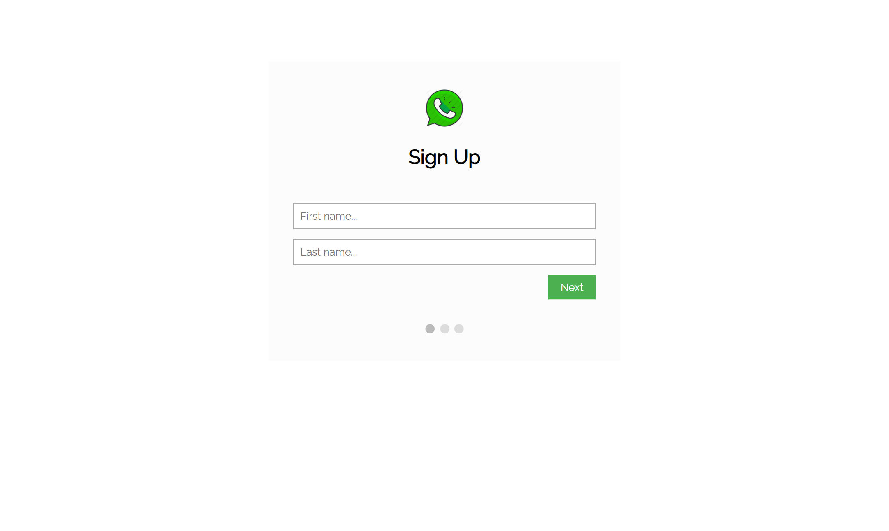
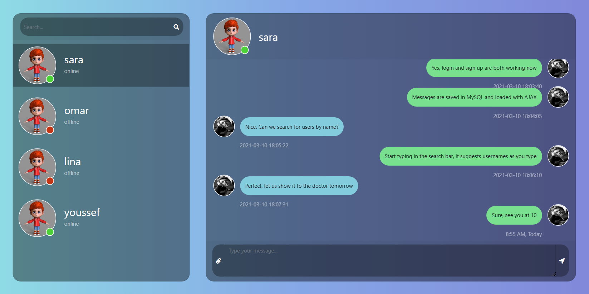
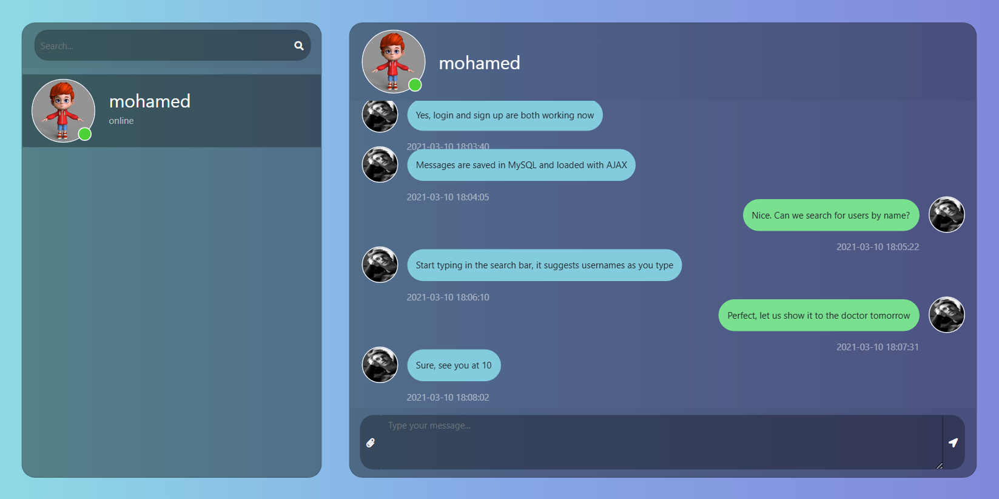
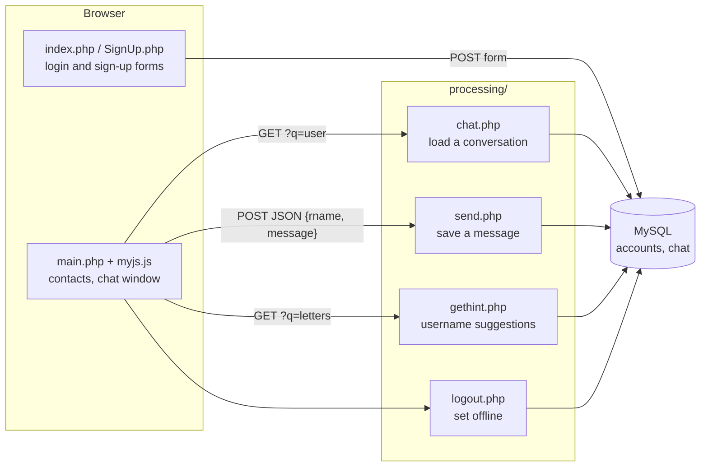
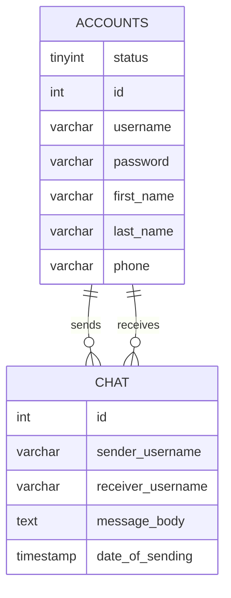

# Chatty: a WhatsApp-style chat website in plain PHP

Chatty is a one-to-one messaging website I built at university in 2021 with PHP, MySQL and JavaScript, without a framework. You sign up, log in, find people by username and chat with them. It works like a small WhatsApp Web.

Screenshots use invented demo users and messages.

---

## What it does

- **Accounts:** sign up (username, password, name, phone) and log in, with PHP sessions
- **Online status:** logging in marks you online, signing out marks you offline, and the contact list shows a green or grey dot
- **Contacts:** the list is built from your chat history, so anyone you've talked to appears there
- **Search:** suggestions appear as you type a username (AJAX), and picking one starts a new chat
- **Chat:** messages are saved in MySQL and loaded as JSON over AJAX. Sent messages show on the right, received ones on the left, each with its time
- **Sending:** click the arrow or press Enter

## Screenshots

| Login | Sign up |
|---|---|
|  |  |
| **Sending a message** | **The same chat from the other user's side** |
|  |  |

## Stack

| Layer | Technology |
|---|---|
| Backend | PHP (procedural), mysqli, PHP sessions |
| Database | MySQL: `accounts` and `chat` tables |
| Frontend | HTML, CSS, Bootstrap, vanilla JavaScript (XMLHttpRequest + JSON), jQuery |

## How it works

### How a message travels

1. You click a contact. `myjs.js` calls `chat.php?q=<username>`.
2. `chat.php` runs two queries, one for messages you sent and one for messages you received. It tags each id with `s` or `r`, merges the two lists, sorts them by id and returns JSON.
3. The browser draws each message on the right (sent) or the left (received).
4. When you send, the message shows on screen right away while `send.php` saves it as a new row.

## Looking back: what I'd change today

I wrote Chatty in 2021, before I had worked on production code. Reading it again in 2026, this is what I'd fix first:

- **Passwords are stored as plain text.** I'd hash them with `password_hash()` and check them with `password_verify()`.
- **SQL injection.** Login and sign-up use prepared statements, but the chat, send, search and logout scripts build SQL by joining strings. Every query should be a prepared statement.
- **XSS.** Messages are inserted into the page with `innerHTML`. They should be escaped, or set with `textContent`.
- **No live updates.** A new message appears only when you open the chat again. Polling or WebSockets would fix that.
- **Data model.** Messages point to usernames, not user ids. I'd use user ids with foreign keys and an index on (sender, receiver).

I applied these lessons in [Baseet](https://github.com/Moham9dHussein/baseet-showcase), my point-of-sale system: BCrypt passwords, JWT auth, prices and totals checked on the server, and every sale in one database transaction.

## Run it locally

1. Install XAMPP (or any PHP 7.4+ with MySQL) and copy the project into `htdocs`.
2. Create the database: run [`database/schema.sql`](database/schema.sql). It also adds the demo users from the screenshots (password `demo123`).
3. Check the connection settings in `processing/config.php` (default: `root` with no password on `localhost`).
4. Open `http://localhost/Chatty/index.php`.

---

**Mohamed Hussein** · Java / Spring Boot developer · [LinkedIn](https://linkedin.com/in/moham9dhussein) · [Baseet showcase](https://github.com/Moham9dHussein/baseet-showcase)
